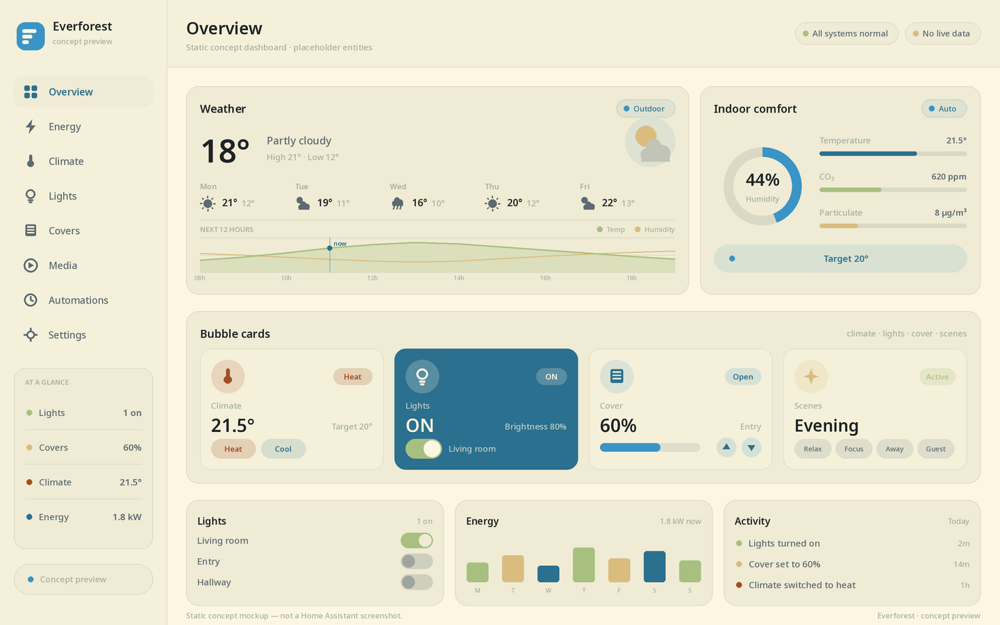
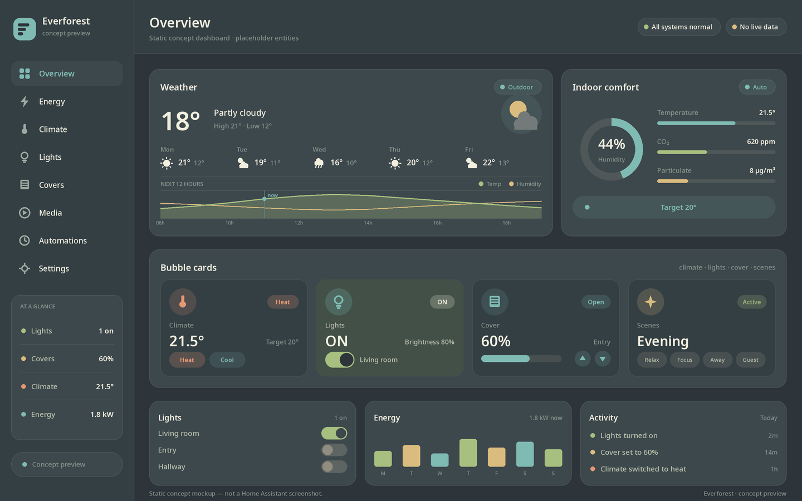

<div align="center">

# Everforest for Home Assistant

**A calm, nature-inspired interface for Home Assistant.**

[](https://my.home-assistant.io/redirect/hacs_repository/?owner=kerdx&repository=home-everforest&category=theme)
[](https://github.com/kerdx/home-everforest/releases/latest)

</div>

Everforest is a theme-only customization for Home Assistant. Choose **Everforest Light** or **Everforest Dark** in your user profile. Each theme defines one mode. No runtime dependencies are required.

## Previews

These are static concept mockups, not screenshots of a Home Assistant instance.

| Everforest Light | Everforest Dark |
| --- | --- |
|  |  |

## Installation

### HACS

Open the [Everforest HACS repository page](https://my.home-assistant.io/redirect/hacs_repository/?owner=kerdx&repository=home-everforest&category=theme), or add `kerdx/home-everforest` as a custom repository and select the **Theme** category. Install the theme, reload themes or restart Home Assistant, then select **Everforest Light** or **Everforest Dark** in your user profile.

### Manual

1. Copy this repository's `themes/` directory into your Home Assistant configuration directory, so the themes are in `config/themes/`.
2. Add this under the existing top-level `frontend:` key in `configuration.yaml` (or add the complete snippet if there is no `frontend:` key):

   ```yaml
   frontend:
     themes: !include_dir_merge_named themes
   ```

   Do not create a duplicate `frontend:` key.
3. Reload themes from **Developer Tools → YAML → Reload themes**, or restart Home Assistant.
4. Select **Everforest Light** or **Everforest Dark** in your user profile.

## Demo dashboard

See [`demo/dashboard.yaml`](demo/dashboard.yaml) for an example dashboard. Bubble Card is optional for the themes, but the demo uses it for its light and climate examples. Replace these placeholder entity IDs with ones from your Home Assistant instance if using the demo:

- `weather.home`
- `climate.living_room`
- `light.living_room`
- `cover.garage_door`
- `sensor.living_room_humidity`

## Issues

Report bugs or request help via [GitHub issues](https://github.com/kerdx/home-everforest/issues).
